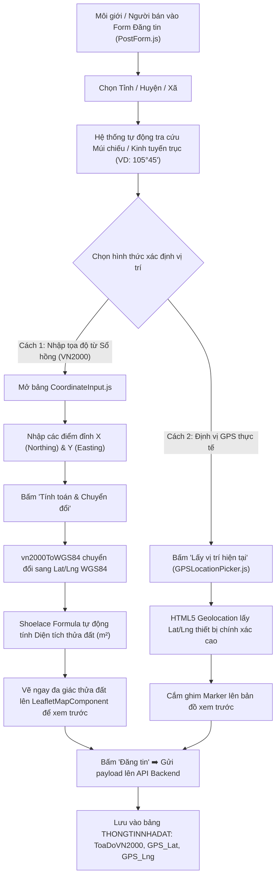
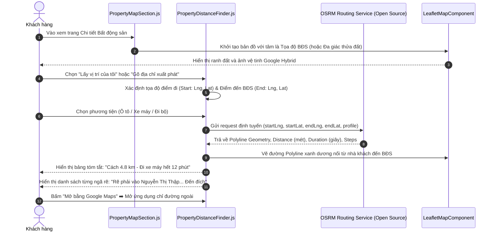

# BÁO CÁO TOÀN DIỆN HỆ THỐNG BẢN ĐỒ & KHÔNG GIAN ĐỊA LÝ (MAP & GIS ARCHITECTURE REVIEW)

> **Mục đích tài liệu**: Báo cáo phân tích chuyên sâu về hệ thống Bản đồ số & Không gian địa lý (GIS) hiện có trong dự án Bất Động Sản 3MAN (DACS-BDSTC). Tài liệu liệt kê chi tiết các tính năng đang hoạt động, danh mục toàn bộ các tệp mã nguồn liên quan, giải thích thuật toán toán học trắc địa và mô tả luồng dữ liệu kiến trúc thực tế.

---

## 1. TỔNG QUAN KIẾN TRÚC BẢN ĐỒ (EXECUTIVE SUMMARY)

Hệ thống Bản đồ & GIS trong dự án là một trong những phân hệ quan trọng và phức tạp nhất, được thiết kế theo tư duy **Hybrid Open GIS**:
1. **100% Độc lập - Không phụ thuộc Google Cloud Billing có phí**: Thay vì sử dụng bộ Google Maps JavaScript API trả phí đắt đỏ của Google Cloud (dễ bị khóa thẻ hoặc giới hạn hạn mức truy vấn), hệ thống tận dụng sức mạnh của **Leaflet GIS** kết hợp với **Google Hybrid/Roadmap Tile Cache**, **Esri World Imagery**, **OSRM Routing Engine**, và **OpenStreetMap Overpass/Nominatim**.
2. **Hỗ trợ Hệ tọa độ Quốc gia VN2000**: Tích hợp thuật toán chuyển đổi toán học trắc địa Gauss-Kruger ngược và mô hình 7 tham số Helmert theo **Quyết định 12/2002/NĐ-CP**, cho phép người dùng nhập trực tiếp tọa độ góc ranh thửa đất từ **Giấy chứng nhận quyền sử dụng đất (Sổ đỏ / Sổ hồng)** để vẽ ranh đất và tự động tính diện tích hình học.
3. **Tích hợp Bản đồ Quy hoạch sử dụng đất (Planning Overlays)**: Cho phép chồng lớp (GroundOverlay) bản đồ quy hoạch xây dựng/sử dụng đất cấp Huyện/Thành phố lên nền bản đồ địa lý thực tế với khả năng chỉnh độ mờ linh hoạt.
4. **Hệ thống Dẫn đường & Phân tích Tiện ích Xung quanh**: Hỗ trợ tự động tính khoảng cách, vẽ lộ trình đa phương tiện (Ô tô, Xe máy/Xe đạp, Đi bộ) và quét bán kính tìm trường học, chợ, bệnh viện, trạm buýt quanh bất động sản.

---

## 2. MA TRẬN TÍNH NĂNG BẢN ĐỒ ĐANG HOẠT ĐỘNG (FEATURES WORKING MATRIX)

| STT | Tên tính năng | Vị trí giao diện | Công nghệ / Nguồn dữ liệu | Mô tả chi tiết năng lực |
|:---:|:---|:---|:---|:---|
| **1** | **Bản đồ số GIS tập trung** | Route `/ban-do` (`MapPage.js`) | Leaflet, Google Hybrid Tiles, Esri Satellite | Hiển thị bản đồ toàn cảnh, chuyển đổi 3 tầng vệ tinh/đường sá, tìm kiếm địa điểm, hiển thị cụm ghim bất động sản toàn hệ thống kèm ảnh, giá, diện tích. |
| **2** | **Ranh giới Hành chính Đa cấp** | `/ban-do` ➡️ Bộ lọc ranh giới | GeoJSON 63 Tỉnh thành (`public/data/gis/`) | Tải và hiển thị ranh giới đa giác (Polygon) Tỉnh/Thành, Quận/Huyện, Phường/Xã. Bật/tắt nhiều lớp cùng lúc và chỉnh thanh trượt độ mờ (Opacity Slider) từng lớp. |
| **3** | **Chồng lớp Bản đồ Quy hoạch** | `/ban-do` & Chi tiết BĐS | KML / PNG GroundOverlay (`public/quyhoach/`) | Nạp ảnh quy hoạch sử dụng đất (ví dụ: Tiền Giang - Mỹ Tho, Cái Lậy, Gò Công 2024–2030) phủ chuẩn xác theo tọa độ khung biên (Bounds: N-S-E-W). |
| **4** | **Dẫn đường & Đo khoảng cách BĐS** | Chi tiết BĐS (`PropertyDistanceFinder`) & `/ban-do` | OSRM Engine (`router.project-osrm.org`) | Tính cự ly (km) và thời gian (phút), chỉ dẫn đường từng ngã rẽ dịch tiếng Việt tự nhiên (3 chế độ: Ô tô, Xe máy, Đi bộ). Hỗ trợ nút mở nhanh Google Maps ngoài. |
| **5** | **Khám phá Tiện ích Xung quanh (POI)** | `/ban-do` ➡️ Tiện ích lân cận | Overpass API (OpenStreetMap) | Quét và ghim các tiện ích theo bán kính (500m, 1km, 2km, 5km, 10km): Trường học, Bệnh viện, Siêu thị, Trạm xe buýt, Nhà hàng, Cây xăng, Ngân hàng... |
| **6** | **Nhập Tọa độ Thửa đất VN2000** | Trang Đăng tin (`PostForm.js` ➡️ `CoordinateInput.js`) | Thuật toán Helmert 7 tham số & Gauss-Kruger | Nhập danh sách tọa độ (X, Y) từ Sổ hồng/Sổ đỏ ➡️ Tự động nhận diện kinh tuyến trục theo tỉnh ➡️ Chuyển sang WGS84 (Lat/Lng) ➡️ Vẽ đa giác ranh đất trực tiếp. |
| **7** | **Tự động Tính Diện tích Thửa đất** | Form VN2000 | Công thức Shoelace / Gauss Polygon Area | Tự tính diện tích thửa đất chuẩn xác bằng m² từ các đỉnh ranh giới nhập vào, đối chiếu với diện tích công bố. |
| **8** | **Định vị GPS Thiết bị Tự động** | Trang Đăng tin (`GPSLocationPicker.js`) | HTML5 Geolocation API | Lấy tọa độ GPS hiện tại của người đăng tin với độ chính xác cao (`enableHighAccuracy`), tự động điền Lat/Lng chỉ bằng 1 cú click. |
| **9** | **Trực quan hóa Thửa đất Tin đăng** | Trang Chi tiết BĐS (`PropertyMapSection.js`) | Leaflet Vector Polygon & Custom Marker | Vẽ chính xác hình dạng thửa đất lên ảnh vệ tinh, giúp người mua nhìn thấy thế đất (nở hậu, vuông vức, mặt tiền đường) trước khi đi xem thực tế. |
| **10** | **Nhãn giá nổi trên Marker (Price Badge Pins)** | Toàn bộ bản đồ (`/ban-do` & Bản đồ BĐS) | HTML5 CSS3 DivIcon & Leaflet Tooltip | Thay thế ghim thông thường bằng viên thuốc hiển thị giá thực tế (`3.5 tỷ`, `850 tr`, `25 tr/th`), phân màu thông minh (Đỏ = Bán, Xanh lục = Thuê, Vàng kim = VIP), mũi nhọn định vị và thẻ xem nhanh Rich Tooltip khi rê chuột giống Airbnb & Batdongsan.com.vn. |
| **11** | **Bảng chú giải màu sắc Quy hoạch (Planning Legend)** | `/ban-do` & Chi tiết BĐS (`PlanningLegendPanel.js`) | Chuẩn Thông tư 27/2018/TT-BTNMT | Tra cứu màu sắc, ký hiệu viết tắt (ODT, ONT, TMD, DGT, CLN, LUC...), giải thích mục đích sử dụng đất, quy chuẩn xây dựng kiên cố, lời khuyên pháp lý và cảnh báo rủi ro (đất dính lộ giới DGT, công viên DKV). Có bộ lọc tab danh mục và ô tìm kiếm tức thì. |
| **12** | **Vòng tròn Bán kính Tiện ích (Radius Search Circle)** | `/ban-do` ➡️ Tiện ích lân cận (`NearbyPlacesPanel.js`) | Leaflet Circle & Custom DivIcon Overlay | Vẽ vòng tròn bán kính động (500m, 1km, 2km, 5km, 10km) với viền nét đứt sang trọng, ghim tâm BĐS gợn sóng (Pulsing Halo Ring `🎯`), nhãn bán kính nổi ở mép trên (`⭕ Bán kính: X km`), tự động căn khung vừa khít (`fitBounds`), kèm các ghim POI dạng thẻ viên thuốc có icon emoji sinh động và khoảng cách thực tế. |
| **13** | **Thước đo khoảng cách & Đo diện tích tự do (Measuring Tools)** | `/ban-do` ➡️ Thước đo (`MeasurementPanel.js` & `measurementUtils.js`) | Thuật toán Chamberlain-Duquette Geodesic & Haversine | Chế độ con trỏ chữ thập (Crosshair); đo chiều dài đường gấp khúc (Line Distance) hiển thị nhãn cự ly từng cạnh; đo diện tích đa giác khép kín (Polygon Area & Perimeter) tự động tính mét vuông ($m^2$), Hecta ($ha$) và Sào theo chuẩn trắc địa WGS84; thẻ diện tích nổi tại trọng tâm đa giác; hỗ trợ tính năng Hoàn tác (Undo) và Xóa (Clear). |
| **14** | **Thanh trượt so sánh Quy hoạch chia đôi màn hình (Before/After Swipe Slider)** | `/ban-do` ➡️ So sánh Swipe (`PlanningSwipeSlider.js`) | Leaflet Custom Pane Clipping & CSS `clip-path` | Chia đôi màn hình so sánh trực quan Hiện trạng (Ảnh vệ tinh thật) và Tương lai (Bản đồ quy hoạch 2030). Thanh trượt chia màn hình kéo thả mượt mà với núm cầm tròn `↔`, tự động cập nhật `clip-path` khi zoom/pan, nhãn chỉ dẫn 2 bên (`📷 Hiện Trạng` / `🗺️ Quy Hoạch`), hỗ trợ đảo chiều (Trái ⇋ Phải), chỉnh độ rõ và tích hợp sẵn 10 khu vực quy hoạch mẫu (Mỹ Tho, Cái Bè, TX Cai Lậy, Gò Công...). |

---

## 3. DANH MỤC TOÀN BỘ CÁC TỆP LIÊN QUAN (CODEBASE FILES AUDIT)

### 3.1. Phân hệ Frontend: Components & Giao diện Bản đồ

1. [MapPage.js](file:///B:/DACN%20(1)/DACS-BDSTC/real-estate-frontend/src/features/map-gis/MapPage.js)
   - **Vai trò**: Component trang chính cho route `/ban-do`.
   - **Nhiệm vụ**: Điều phối kích thước toàn màn hình (full-height layout), lưu giữ tọa độ trung tâm, nạp dữ liệu quy hoạch theo quận/huyện được chọn thông qua `loadPlanningData`.
2. [GoogleMapComponent.js](file:///B:/DACN%20(1)/DACS-BDSTC/real-estate-frontend/src/features/map-gis/GoogleMapComponent.js)
   - **Vai trò**: Core container bản đồ thông minh cho trang bản đồ tập trung (mặc dù tên file là GoogleMapComponent để giữ tương thích ngược, thực tế lõi dựng trên nền Leaflet Engine tốc độ cao).
   - **Nhiệm vụ**: Khởi tạo bản đồ, quản lý các lớp tile layer (Google Hybrid vệ tinh tiếng Việt, Google Roadmap), quản lý danh sách Marker bất động sản, tích hợp panel tìm kiếm, panel ranh giới, panel tiện ích và panel chỉ đường.
3. [LeafletMapComponent.js](file:///B:/DACN%20(1)/DACS-BDSTC/real-estate-frontend/src/features/map-gis/LeafletMapComponent.js)
   - **Vai trò**: Lõi bản đồ Leaflet độc lập đa năng, tối ưu hóa hiển thị nhanh cho trang Chi tiết tin đăng và Xem trước trong Form đăng tin.
   - **Nhiệm vụ**: Vẽ ranh giới thửa đất (Polygon), ghim vị trí tâm (Marker ghim đỏ/xanh), vẽ lộ trình OSRM (Polyline xanh dương), điều chỉnh khung nhìn vừa vặn ranh đất (`fitBounds`), chuyển đổi 3 nguồn ảnh nền (Vệ tinh Google, Bản đồ đường, Vệ tinh Esri).
4. [PropertyMapSection.js](file:///B:/DACN%20(1)/DACS-BDSTC/real-estate-frontend/src/features/properties/property-detail/PropertyMapSection.js)
   - **Vai trò**: Khối bản đồ hiển thị trong trang Chi tiết Bất động sản (`PropertyDetail.js`).
   - **Nhiệm vụ**: Xác định tâm bản đồ dựa trên trọng tâm đa giác thửa đất VN2000 hoặc tọa độ GPS, nhúng `LeafletMapComponent` cùng bảng công cụ đo khoảng cách `PropertyDistanceFinder`.
5. [PropertyDistanceFinder.js](file:///B:/DACN%20(1)/DACS-BDSTC/real-estate-frontend/src/features/properties/property-detail/PropertyDistanceFinder.js)
   - **Vai trò**: Bộ công cụ đo khoảng cách và tìm đường thông minh tích hợp sẵn trong trang chi tiết nhà đất.
   - **Nhiệm vụ**: Cho phép khách xem chọn điểm xuất phát (bằng GPS hiện tại, gõ địa chỉ tìm kiếm gợi ý qua Nominatim, hoặc click trực tiếp lên bản đồ), chọn phương tiện (xe máy, ô tô, đi bộ), gọi OSRM để lấy đường đi và phân tích thành danh sách hướng dẫn rẽ chi tiết bằng tiếng Việt.
6. [CoordinateInput.js](file:///B:/DACN%20(1)/DACS-BDSTC/real-estate-frontend/src/features/map-gis/CoordinateInput.js)
   - **Vai trò**: Bảng nhập liệu tọa độ trắc địa VN2000 trong form đăng tin (`PostForm.js`).
   - **Nhiệm vụ**: Cho phép thêm các điểm góc ranh (X, Y), tự động chọn kinh tuyến trục dựa trên Tỉnh/Thành được chọn, bấm "Tính toán & Chuyển đổi" để tính diện tích m² và tạo ra mảng tọa độ WGS84.
7. [GPSLocationPicker.js](file:///B:/DACN%20(1)/DACS-BDSTC/real-estate-frontend/src/features/map-gis/GPSLocationPicker.js)
   - **Vai trò**: Bộ widget lấy vị trí GPS thực tế từ thiết bị.
   - **Nhiệm vụ**: Tương tác với `navigator.geolocation`, xử lý các mã lỗi quyền truy cập và trả về vĩ độ/kinh độ chính xác đến 6 chữ số thập phân.
8. [DirectionsPanel.js](file:///B:/DACN%20(1)/DACS-BDSTC/real-estate-frontend/src/features/map-gis/DirectionsPanel.js)
   - **Vai trò**: Bảng điều khiển chỉ đường độc lập trên trang Bản đồ GIS `/ban-do`.
   - **Nhiệm vụ**: Tìm đường giữa hai điểm bất kỳ trên bản đồ với hỗ trợ autocomplete tìm kiếm địa điểm và click chọn điểm trên map.
9. [NearbyPlacesPanel.js](file:///B:/DACN%20(1)/DACS-BDSTC/real-estate-frontend/src/features/map-gis/NearbyPlacesPanel.js)
   - **Vai trò**: Bảng điều khiển tra cứu tiện ích ngoại khu.
   - **Nhiệm vụ**: Cho phép chọn loại địa điểm (trường học, bệnh viện, chợ...), bán kính tìm kiếm (500m - 10km), gọi Overpass API và hiển thị kết quả theo danh sách sắp xếp theo khoảng cách.
10. [PlanningOverlay.js](file:///B:/DACN%20(1)/DACS-BDSTC/real-estate-frontend/src/features/map-gis/PlanningOverlay.js)
    - **Vai trò**: Component xử lý lớp phủ quy hoạch đất.
    - **Nhiệm vụ**: Nạp dữ liệu các mảnh overlay bản đồ quy hoạch, gán tọa độ giới hạn (Southwest, Northeast) và vẽ ảnh quy hoạch với độ mờ tùy chỉnh.
11. [PlaceDetailCard.js](file:///B:/DACN%20(1)/DACS-BDSTC/real-estate-frontend/src/features/map-gis/PlaceDetailCard.js)
    - **Vai trò**: Thẻ popup hiển thị tóm tắt thông tin tin đăng khi click vào một Marker trên bản đồ.
12. [google-map/AdminBoundariesPanel.js](file:///B:/DACN%20(1)/DACS-BDSTC/real-estate-frontend/src/features/map-gis/google-map/AdminBoundariesPanel.js)
    - **Vai trò**: Bảng quản lý các lớp ranh giới hành chính đang bật trên bản đồ.
    - **Nhiệm vụ**: Hiển thị danh sách các lớp Tỉnh/Huyện/Xã đang vẽ, kèm thanh kéo chỉnh độ mờ (opacity) và nút xóa từng lớp hoặc xóa tất cả.
13. [google-map/MapControls.js](file:///B:/DACN%20(1)/DACS-BDSTC/real-estate-frontend/src/features/map-gis/google-map/MapControls.js)
    - **Vai trò**: Cụm nút điều khiển bản đồ nổi (chọn loại bản đồ, phóng to/thu nhỏ, mở panel quy hoạch, vị trí của tôi, reset góc nhìn).
14. [google-map/MapPolygonsAndMarkers.js](file:///B:/DACN%20(1)/DACS-BDSTC/real-estate-frontend/src/features/map-gis/google-map/MapPolygonsAndMarkers.js)
    - **Vai trò**: Sub-component phụ trách việc quản lý render các lớp vector đa giác và cụm marker.
15. [PlanningLegendPanel.js](file:///B:/DACN%20(1)/DACS-BDSTC/real-estate-frontend/src/features/map-gis/PlanningLegendPanel.js)
    - **Vai trò**: Bảng chú giải tra cứu màu sắc & ký hiệu quy hoạch đất.
    - **Nhiệm vụ**: Cung cấp bộ dữ liệu đầy đủ 15+ loại đất phổ biến (ODT, ONT, TMD, SKK, SKC, DGT, DKV, CLN, LUC, HNK, NTS, RSX...) chuẩn Thông tư 27/2018/TT-BTNMT, kèm hộp màu chuẩn, giải thích mục đích sử dụng, lưu ý pháp lý, cảnh báo lộ giới, bộ lọc danh mục và ô tìm kiếm tức thì. Hỗ trợ chế độ thu nhỏ (minimize) linh hoạt.
16. [MeasurementPanel.js](file:///B:/DACN%20(1)/DACS-BDSTC/real-estate-frontend/src/features/map-gis/MeasurementPanel.js)
    - **Vai trò**: Bảng điều khiển công cụ đo đạc bản đồ số (Measuring Tool Panel).
    - **Nhiệm vụ**: Cung cấp giao diện đo khoảng cách (đường gấp khúc) và đo diện tích tự do (đa giác khép kín). Hiển thị trực tiếp tổng chiều dài ($m$, $km$), diện tích ($m^2$, $ha$, sào), chu vi, danh sách chi tiết các cạnh, nút Hoàn tác (Undo) và Xóa sạch (Clear).
17. [PlanningSwipeSlider.js](file:///B:/DACN%20(1)/DACS-BDSTC/real-estate-frontend/src/features/map-gis/PlanningSwipeSlider.js)
    - **Vai trò**: Bộ điều khiển thanh trượt so sánh chia đôi màn hình (Before/After Swipe Slider).
    - **Nhiệm vụ**: Quản lý thanh phân cách dọc kéo thả tự do, tự động tính toán viewport layer points để cắt mặt nạ (`clip` / `clip-path`) trên pane quy hoạch `planningSwipePane` theo thời gian thực khi di chuyển chuột, thu phóng bản đồ. Cung cấp bộ công cụ đảo chiều 2 bên, tùy biến độ trong suốt, và tích hợp sẵn 10 khu vực quy hoạch mẫu.

---

### 3.2. Phân hệ Frontend: Hooks & Xử lý Logic Nghiệp vụ GIS

1. [useGISLogic.js](file:///B:/DACN%20(1)/DACS-BDSTC/real-estate-frontend/src/hooks/useGISLogic.js)
   - **Vai trò**: Custom Hook trung tâm xử lý dữ liệu GIS và ranh giới hành chính.
   - **Nhiệm vụ**: Tải file mục lục phân cấp `sorted.json`, nạp dữ liệu GeoJSON động theo mã tỉnh (`/data/gis/[id].json`), lưu giữ danh sách ranh giới đang chọn, quản lý độ mờ từng lớp, và hỗ trợ thuật toán Point-in-Polygon để nhận biết người dùng click vào xã/huyện nào.
2. [usePropertyLogic.js](file:///B:/DACN%20(1)/DACS-BDSTC/real-estate-frontend/src/hooks/usePropertyLogic.js)
   - **Vai trò**: Custom Hook lọc và xử lý danh sách bất động sản hiển thị lên bản đồ (đồng bộ hóa với thanh tìm kiếm loại nhà đất, mức giá, diện tích).

---

### 3.3. Phân hệ Frontend: Thư viện Thuật toán & Utilities

1. [priceMarkerUtils.js](file:///B:/DACN%20(1)/DACS-BDSTC/real-estate-frontend/src/features/map-gis/priceMarkerUtils.js)
   - **Vai trò**: Bộ điều phối nhãn giá trực quan chuẩn Airbnb & Batdongsan.
   - **Nhiệm vụ**: Format giá tiền ngắn gọn (`formatPriceBadge`), tạo Leaflet DivIcon viên thuốc nổi bật (`createPriceBadgeIcon`) phân biệt màu Bán/Thuê/VIP, và tạo thẻ Rich Tooltip HTML xem nhanh khi rê chuột (`createPropertyTooltipHtml`).
2. [measurementUtils.js](file:///B:/DACN%20(1)/DACS-BDSTC/real-estate-frontend/src/features/map-gis/measurementUtils.js)
   - **Vai trò**: Thư viện toán học trắc địa chuyên sâu phục vụ công cụ đo đạc GIS.
   - **Nhiệm vụ**:
     - `calculateGeodesicDistance`: Tính khoảng cách trắc địa Haversine giữa 2 điểm WGS84 ($R = 6,378,137\text{ m}$).
     - `calculatePolylineDistance`: Tính tổng cự ly đường gấp khúc.
     - `calculatePolygonArea`: Tính diện tích đa giác mặt cầu chuẩn thuật toán Chamberlain-Duquette (1964) / Girard's Spherical Excess, quy đổi sang $m^2$, Hecta ($ha$) và Sào.
     - `calculatePolygonPerimeter`: Tính chu vi đa giác.
     - `getSegmentMidpoint` & `getPolygonCentroid`: Xác định tọa độ đặt nhãn khoảng cách từng cạnh và nhãn diện tích tại tâm đa giác.
2. [coordinateConverter.js](file:///B:/DACN%20(1)/DACS-BDSTC/real-estate-frontend/src/utils/coordinateConverter.js)
   - **Nhiệm vụ**:
     - Định nghĩa tham số trắc địa của 63 tỉnh thành Việt Nam theo Quyết định 12/2002/NĐ-CP (kinh tuyến trục 3 độ từ 104°00' đến 108°30').
     - Hàm `vn2000ToWGS84(x, y, muiChieu)`: Thực hiện phép chiếu Gauss-Kruger ngược (Inverse Transverse Mercator Projection) chuyển đổi tọa độ phẳng (Northing, Easting) sang tọa độ phỏng cầu ellipsoid Krasovsky/VN2000, sau đó áp dụng phép biến đổi không gian 7 tham số Helmert sang ellipsoid WGS84.
     - Hàm `calculateDistance(lat1, lon1, lat2, lon2)`: Tính khoảng cách cung lớn bề mặt cầu giữa hai điểm theo công thức Haversine.
     - Hàm `getMeridianFromProvinceName(provinceName)`: Tự động tra cứu kinh tuyến trục chuẩn dựa trên tên tỉnh/thành phố.
2. [gisUtils.js](file:///B:/DACN%20(1)/DACS-BDSTC/real-estate-frontend/src/utils/gisUtils.js)
   - **Nhiệm vụ**:
     - Hàm `calculatePolygonArea(coordinates)`: Tính diện tích đa giác khép kín bằng công thức Shoelace (Gauss Formula) cho mặt phẳng hoặc diện tích mặt cầu.
     - Hàm chuẩn hóa và chuyển đổi cấu trúc tọa độ qua lại giữa các định dạng (mảng `[lat, lng]`, đối tượng `{lat, lng}`, hoặc GeoJSON `[lng, lat]`).
3. [osmRoutingService.js](file:///B:/DACN%20(1)/DACS-BDSTC/real-estate-frontend/src/utils/osmRoutingService.js)
   - **Nhiệm vụ**:
     - Hàm `getRouteFromOSRM(startLng, startLat, endLng, endLat, profile)`: Kết nối đến OSRM Routing API với các profile `driving` (ô tô), `cycling` (xe máy/xe đạp), `walking` (đi bộ).
     - Trả về tọa độ toàn bộ đường gấp khúc (Polyline Geometry), tổng chiều dài mét, thời gian di chuyển giây, và mảng các bước ngoặt giao lộ (`legs[0].steps`).
     - Hàm `formatDistance` (m/km) và `formatDuration` (giờ/phút) thân thiện với người dùng Việt Nam.
4. [planningDataLoader.js](file:///B:/DACN%20(1)/DACS-BDSTC/real-estate-frontend/src/utils/planningDataLoader.js)
   - **Nhiệm vụ**: Tìm kiếm và nạp tệp quy hoạch `index.json` tương ứng với Tỉnh và Huyện trong thư mục `public/quyhoach/`, tự động chuẩn hóa tên bỏ dấu tiếng Việt (ví dụ: "Tiền Giang" ➡️ "Tien_Giang", "Cái Bè" ➡️ "Cai_Be_2030").
5. [overpassService.js](file:///B:/DACN%20(1)/DACS-BDSTC/real-estate-frontend/src/utils/overpassService.js)
   - **Nhiệm vụ**: Soạn cú pháp truy vấn QL của Overpass OSM để quét các node xung quanh tọa độ tâm trong bán kính định sẵn và phân loại tiện ích theo thẻ OSM (`amenity=school`, `amenity=hospital`, `shop=supermarket`...).
6. [nominatimService.js](file:///B:/DACN%20(1)/DACS-BDSTC/real-estate-frontend/src/utils/nominatimService.js)
   - **Nhiệm vụ**: Reverse Geocoding (từ tọa độ Lat/Lng lấy ra tên địa chỉ tiếng Việt cụ thể) và Geocoding (tìm kiếm vị trí từ chuỗi văn bản gõ vào).
7. [provinceMapping.js](file:///B:/DACN%20(1)/DACS-BDSTC/real-estate-frontend/src/utils/provinceMapping.js)
   - **Nhiệm vụ**: Bảng đối chiếu mã số đơn vị hành chính và tên viết tắt của các tỉnh thành Việt Nam.
8. [pointInPolygon.js](file:///B:/DACN%20(1)/DACS-BDSTC/real-estate-frontend/src/utils/pointInPolygon.js)
   - **Nhiệm vụ**: Thuật toán Ray-Casting kiểm tra một điểm tọa độ bất kỳ đang nằm trong ranh giới của Phường/Xã hay Huyện nào.

---

### 3.4. Phân hệ Backend: API & Cơ sở dữ liệu

1. [locations.js](file:///B:/DACN%20(1)/DACS-BDSTC/real-estate-backend/routes/locations.js)
   - **Đường dẫn**: `/api/locations`
   - **Các Endpoint**:
     - `GET /api/locations/provinces`: Lấy danh sách 63 tỉnh/thành phố.
     - `GET /api/locations/districts/:provinceId`: Lấy danh sách quận/huyện theo mã tỉnh.
     - `GET /api/locations/wards/:districtId`: Lấy danh sách phường/xã theo mã huyện.
2. [locationController.js](file:///B:/DACN%20(1)/DACS-BDSTC/real-estate-backend/controllers/locationController.js) & [locationService.js](file:///B:/DACN%20(1)/DACS-BDSTC/real-estate-backend/services/locationService.js)
   - **Nhiệm vụ**: Truy vấn cơ sở dữ liệu MySQL các bảng địa giới hành chính (`TINHTHANH`, `QUANHUYEN`, `PHUONGXA`) trả về JSON cho dropdown bộ lọc.
3. [propertyService.js](file:///B:/DACN%20(1)/DACS-BDSTC/real-estate-backend/services/propertyService.js) & [properties.js](file:///B:/DACN%20(1)/DACS-BDSTC/real-estate-backend/routes/properties.js)
   - **Nhiệm vụ**: Lưu trữ và truy xuất các trường dữ liệu tọa độ không gian khi tạo/sửa tin đăng:
     - `ToaDoVN2000` (dạng JSON chuỗi lưu đỉnh thửa đất, múi chiếu, diện tích, tọa độ WGS84 chuyển đổi).
     - `GPS_Lat` và `GPS_Lng` (kiểu Decimal độ chính xác 8 chữ số thập phân).
     - Hỗ trợ API tìm kiếm bất động sản theo tọa độ và ranh giới địa lý.
4. [coordinateConverter.js (Backend)](file:///B:/DACN%20(1)/DACS-BDSTC/real-estate-backend/utils/coordinateConverter.js)
   - **Nhiệm vụ**: Cung cấp hàm chuyển đổi VN2000 phía server để hỗ trợ kiểm tra tính hợp lệ của tọa độ trước khi lưu vào Database.
5. **Cấu trúc Bảng Cơ sở dữ liệu MySQL**:
   - `THONGTINNHADAT`: Chứa các trường địa lý:
     - `DiaChi VARCHAR(255)`
     - `MaTinh VARCHAR(20)`, `MaHuyen VARCHAR(20)`, `MaXa VARCHAR(20)`
     - `ToaDoVN2000 LONGTEXT` (Lưu trọn vẹn JSON định dạng thửa đất)
     - `GPS_Lat DECIMAL(10,8)`
     - `GPS_Lng DECIMAL(11,8)`
   - `TINHTHANH`, `QUANHUYEN`, `PHUONGXA`: Lưu danh mục chuẩn địa giới hành chính toàn quốc.

---

### 3.5. Dữ liệu Không gian Tĩnh (GIS Static Datasets)

Hệ thống lưu trữ sẵn kho dữ liệu không gian phong phú trong thư mục `real-estate-frontend/public/`:
1. `public/data/sorted.json` (763 KB): Bảng mục lục quan hệ phân cấp Tỉnh ➡️ Huyện ➡️ Xã của toàn bộ 63 tỉnh thành Việt Nam.
2. `public/data/dvhcvn.json` (1.45 MB): Danh mục đơn vị hành chính Việt Nam đầy đủ thông tin mã số và tên chuẩn hóa.
3. `public/data/gis/[01-96].json`: 63 tệp GeoJSON biên giới đa giác của 63 tỉnh thành (bao gồm cả đa giác cấp Quận/Huyện bên trong).
4. `public/quyhoach/`: Cây thư mục lưu trữ ảnh quy hoạch và tệp KML/JSON theo địa phương (ví dụ tỉnh Tiền Giang gồm 11 đơn vị hành chính: Mỹ Tho, Cai Lậy, Cái Bè, Gò Công...).

---

## 4. CHI TIẾT CÁC QUY TRÌNH HOẠT ĐỘNG CHÍNH (KEY WORKFLOWS)

### 4.1. Quy trình Nhập liệu Tọa độ Thửa đất VN2000 & GPS khi Đăng tin

---

### 4.2. Quy trình Khách hàng Xem Bản đồ, Đo Khoảng cách & Chỉ đường

---

### 4.3. Quy trình Tra cứu Quy hoạch & Ranh giới Hành chính (`/ban-do`)

1. Người dùng truy cập đường dẫn `/ban-do`.
2. Hệ thống tải bản đồ số với các Marker của tất cả tin đăng nhà đất đang hoạt động.
3. Người dùng chọn một Quận/Huyện trên thanh tìm kiếm.
4. `useGISLogic` kích hoạt:
   - Tải file GeoJSON tương ứng để vẽ đường biên giới viền đa giác của Huyện đó.
   - Thêm vào danh sách `selectedBoundaries` để người dùng có thể tùy chỉnh thanh trượt độ trong suốt (0% - 100%).
5. `loadPlanningData` kích hoạt:
   - Đọc thư mục quy hoạch `/quyhoach/[Province]/[District_Year]/index.json`.
   - Lấy danh sách các mảnh bản đồ quy hoạch kèm tọa độ Bounds (Tây Nam - Đông Bắc).
   - Dựng các lớp `GroundOverlay` phủ chính xác lên nền bản đồ vệ tinh.
6. Người dùng quan sát thấy thửa đất nằm trong loại đất nào (Đất ở đô thị ODT, đất trồng cây lâu năm CLN, đất giao thông...).

---

## 5. TỔNG KẾT ĐÁNH GIÁ CHUYÊN MÔN (TECHNICAL EVALUATION)

### Điểm mạnh nổi bật:
- **Tối ưu chi phí tuyệt đối**: Không phát sinh chi phí duy trì Google Maps API đắt đỏ, nhưng vẫn đảm bảo giao diện ảnh vệ tinh nét căng có tên đường tiếng Việt nhờ giải pháp Leaflet + Google Hybrid Tiles.
- **Đúng chuẩn pháp lý đo đạc Việt Nam**: Tích hợp thuật toán chuyển đổi VN2000 chuẩn Quyết định 12/2002/NĐ-CP – tính năng chỉ có ở các phần mềm địa chính chuyên nghiệp hoặc cổng quy hoạch lớn như Guland / Remaps.
- **Trải nghiệm người dùng mượt mà**: Toàn bộ hệ thống bản đồ được module hóa sạch sẽ thành các sub-components gọn gàng (dưới 200 dòng mỗi file), giảm thiểu tình trạng giật lag hoặc re-render vô ích.
- **Đầy đủ tiện ích thực tế**: Hỗ trợ dẫn đường đa phương tiện có giọng chỉ đường tiếng Việt, đo khoảng cách thực tế và quét tiện ích xung quanh (trường, chợ, bệnh viện).

---
*Tài liệu được lập tự động dựa trên mã nguồn thực tế của dự án Bất Động Sản 3MAN.*
